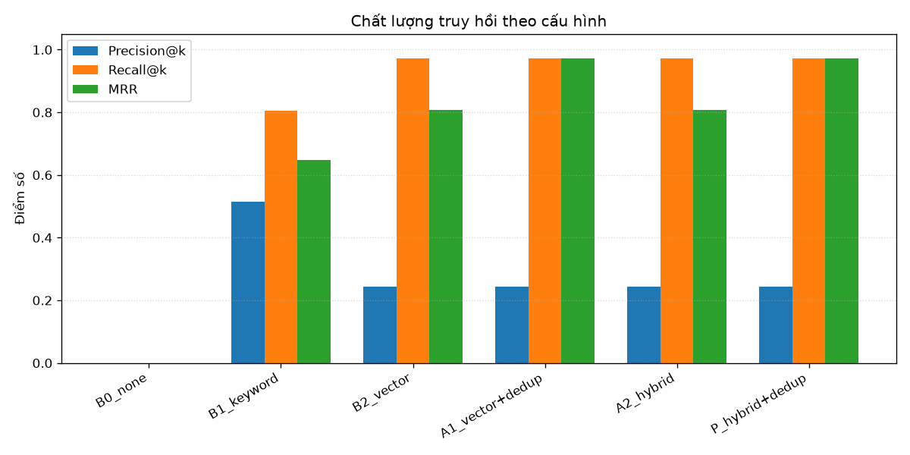
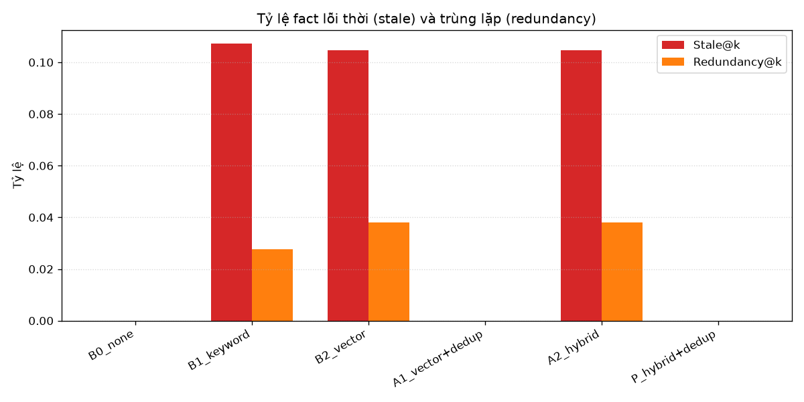
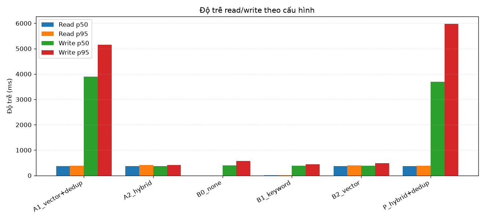
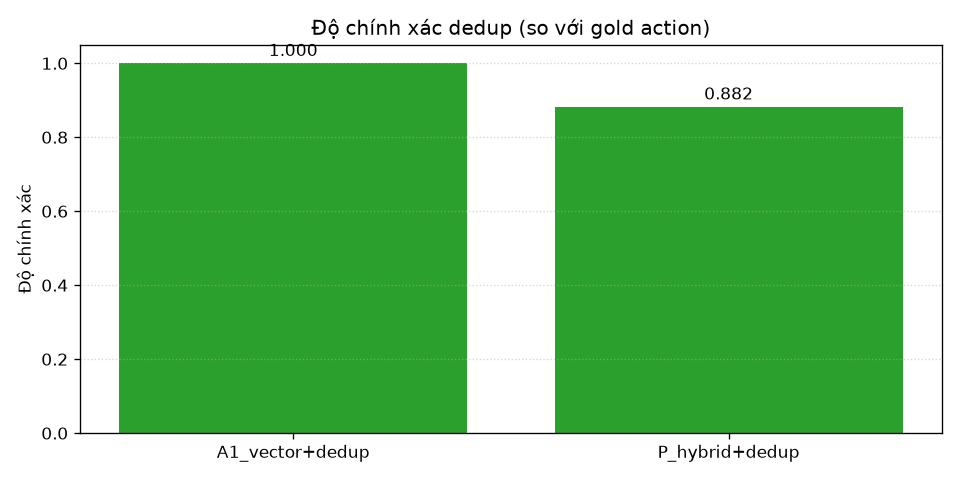

# Tong hop ket qua Track A

Nguon du lieu: `eval\results\track_a_20261007_093100.json`

## 1. Chat luong truy hoi (trung binh toan dataset)

| Config | Precision@k | Recall@k | MRR | Stale@k | Redundancy@k | FP (no_relevant) |
|---|---|---|---|---|---|---|
| B0_none | 0.000 | 0.000 | 0.000 | 0.000 | 0.000 | 0.000 |
| B1_keyword | 0.514 | 0.806 | 0.648 | 0.107 | 0.028 | 0.333 |
| B2_vector | 0.244 | 0.972 | 0.807 | 0.105 | 0.038 | 1.000 |
| A1_vector+dedup | 0.244 | 0.972 | 0.972 | 0.000 | 0.000 | 1.000 |
| A2_hybrid | 0.244 | 0.972 | 0.807 | 0.105 | 0.038 | 1.000 |
| P_hybrid+dedup | 0.244 | 0.972 | 0.972 | 0.000 | 0.000 | 1.000 |

## 2. Do tre (ms)

| Config | Read p50 | Read p95 | Write p50 | Write p95 |
|---|---|---|---|---|
| A1_vector+dedup | 368 | 389 | 3896 | 5147 |
| A2_hybrid | 368 | 408 | 370 | 407 |
| B0_none | 0 | 0 | 402 | 569 |
| B1_keyword | 7 | 8 | 386 | 444 |
| B2_vector | 368 | 403 | 384 | 483 |
| P_hybrid+dedup | 366 | 379 | 3687 | 5971 |

## 3. Do chinh xac dedup

| Config | Accuracy |
|---|---|
| A1_vector+dedup | 1.000 |
| P_hybrid+dedup | 0.882 |

